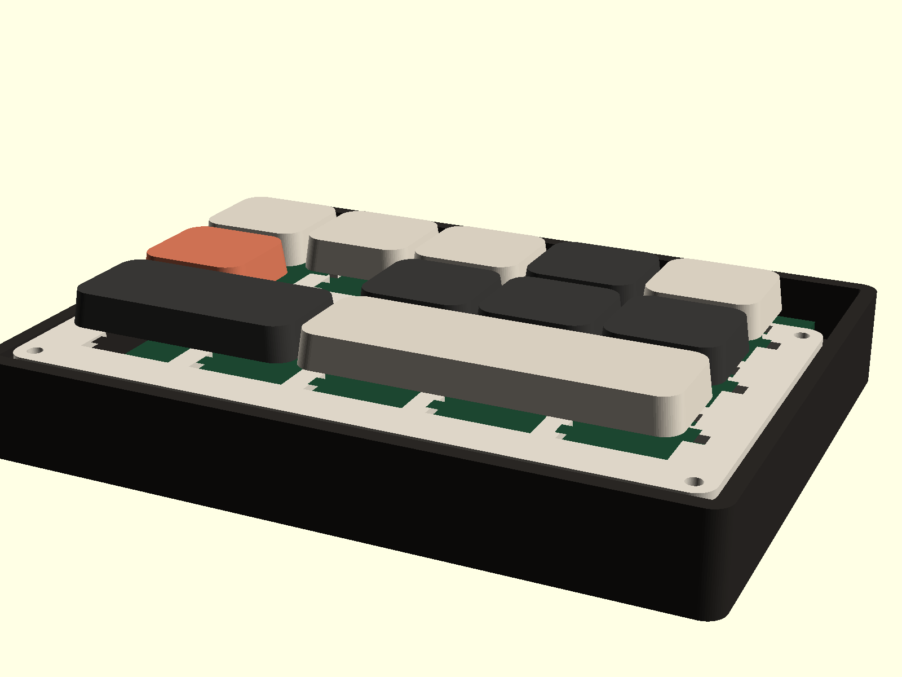

# ClaudePad

专为 Claude Code 打造的 ZMK 宏键盘：11 个按键，把权限切换、打断、模型切换、`@` 文件引用和语音对讲映射到实体键上。

- 固件：ZMK（Seeed XIAO nRF52840，ZMK 板名 `xiao_ble//zmk`）
- 上位机：Windows + Python 3.12，零第三方依赖
- PCB：2 层、90 × 76 mm、1.6 mm；XIAO 为 **14 个穿孔焊盘（2×7 2.54mm 排针）**，11 个二极管、14 颗 Choc V2 轴
- 外壳：3D 打印底座 + 定位板 + 键帽，整机约 108 × 82 × 23.1 mm；控制器仓敞开，USB-C/RESET 可直接操作；后壁 USB-C 开口已按排针高度上移
- 主控：XIAO 自带 USB-C、**可按的 RESET 键**、锂电池充电与 BAT 焊盘；通过 **2×7 2.54mm 排针穿孔焊接**
- 供电：**无电源开关**，JST 电池插头 + ZMK 深度睡眠；长期存放时拔掉电池



更多预览：[正俯视](docs/preview/claudepad-top.png)｜[爆炸图](docs/preview/claudepad-exploded.png)｜[PCB](docs/preview/claudepad-pcb.png)

## 键位

```
PERM   MODEL   CMD    ↑    VOICE
STOP   (空)           ←    ↓    →
ENTER (2u)          SPACE (3u)
```

| 键 | 单击 | 双击 | 长按 |
|---|---|---|---|
| PERM | `Shift+Tab` 循环权限档位（另发 `F16` 供上位机同步档位） | — | 250ms → `Ctrl+Alt+Shift+F15`（上位机复位到 default） |
| MODEL | 输入 `/model` + Enter | — | 250ms → `Ctrl+Alt+Shift+F14`（上位机循环模型） |
| CMD | `/` | — | 200ms → `@` |
| STOP | `Esc` 打断 | 200ms 内双击 → `Ctrl+C` | 1200ms → `Ctrl+C` ×2 退出会话 |
| ENTER | `Enter` | 200ms 内双击 → `Shift+Enter` | — |
| SPACE | `Space` | — | 300ms → `Tab`（带三重防误触） |
| VOICE | `Space` | 180ms 内双击 → `/voice` | 按住 → `Space` 对讲 |
| ← ↑ ↓ → | 方向键，系统原生自动重复 | — | — |

> 审批功能已取消：没有拨杆、没有自动批准。Claude Code 的权限提示仍由人工回答。PERM 单击额外发送一个 **F16** 同步信号，让上位机在 Claude Code 不暴露当前档位的情况下仍能准确计算复位次数。

## 仓库结构

```
build.yaml / .github/workflows/build.yml   ZMK 构建
config/west.yml                            ZMK manifest
config/boards/shields/claudepad/           shield：矩阵、布局、键位
pcb/                                       KiCad PCB、封装、Gerber、BOM、设计包
cad/                                       OpenSCAD 外壳/定位板/键帽 + STL
host/                                      Windows 上位机
  claudepad_host/                          守护进程、动作、安装器、状态逻辑
  scripts/                                 statusLine / hooks 脚本
  tests/                                   单元测试
docs/BOM.md                                购物清单
docs/pcb.md                                PCB 制造、网络表、焊接顺序
docs/cad.md                                外壳/定位板/键帽打印与装配
docs/wiring.md                             手工飞线备用方案
docs/keymap.md                             键位与时间参数
docs/preview/                              成品/PCB 预览图
tools/check_firmware.py                    固件静态检查
tools/check_cad.py                         STL 尺寸与闭合检查
tools/check_hardware.py                    PCB ↔ 外壳坐标一致性检查
```

## 0. 制造硬件

1. **PCB**：把 `pcb/output/claudepad-jlcpcb-gerbers.zip` 发给嘉立创/JLCPCB，选 **2 层、1.6mm、1oz、无铅喷锡**，不需要 SMT 贴片。完整设计（KiCad 工程 + 制造文件 + BOM + 3D）在 `pcb/output/claudepad-pcb-design.zip`。DRC 已通过：0 错误、0 未连接。
2. **外壳**：先打印 `cad/output/stl/test_coupon.stl`，用真实轴体确定 `SWITCH_PLATE_GAP`，修改 `cad/params.scad` 后重新导出；再打印底座、定位板、键帽。详见 [docs/cad.md](docs/cad.md)。
3. **焊接**：按 [docs/pcb.md](docs/pcb.md) 的顺序先焊 XIAO 电池线，再把 XIAO 焊到 2×7 2.54mm 排针、插入 PCB 的 14 个穿孔，然后焊轴体、二极管、JST。排针焊完后从背面把过长针脚剪到 ≤4mm。注意 XIAO 的 BAT 焊盘在背面，要先处理电池线再装模块。
4. **装配**：PCB 放在底座支撑柱上 → 装定位板 → 4 颗 M2×6 自攻螺丝 → 键帽 → 接电池。

## 1. 编译固件

把整个目录推到 GitHub 仓库即可：`.github/workflows/build.yml` 会调用 ZMK 官方 workflow，在 Actions 里产出 `claudepad-xiao_ble-zmk.uf2`（以 Actions 产物名为准）。

```bash
git init
git add .
git commit -m "ClaudePad v1"
git branch -M main
git remote add origin https://github.com/<用户名>/<仓库名>.git
git push -u origin main
```

推上去就自动触发构建；绿勾后在该次 run 页面底部 **Artifacts** 下载 `firmware`，里面是 `claudepad-xiao_ble-zmk.uf2`。仓库需是空仓库（不要先勾 README/.gitignore）；后续改键位再 `git commit && git push` 会重新构建。

本地编译需要 west + Zephyr SDK，参考 [ZMK 本地构建文档](https://zmk.dev/docs/development/local-toolchain/build)。

刷机：**双击 XIAO 板上 USB-C 旁边的 RESET 键**进入 bootloader，把 `.uf2` 拖进去。首次使用在系统蓝牙里配对 `ClaudePad`。

> XIAO 的 USB-C 与 RESET 键在同一条边；外壳后壁有 USB-C 凹槽/开口，控制器仓敞开，刷机时可直接按 RESET。电池通过 XIAO 背面 BAT 焊盘 → PCB 窗口 → BAT1/JST 连接（详见 docs/pcb.md）。

## 2. 安装上位机（Windows）

需要 Python 3.10+（已在 3.12 上测试），不需要安装任何第三方包。

```bash
cd host
python -m claudepad_host install
python -m claudepad_host run
```

- `install` 会备份 `~/.claude/settings.json`，然后把 hooks 和 statusLine 指向 `~/.claude/claudepad/` 下的脚本。
- `run` 启动守护进程，监听复位 `F15`、模型 `F14`、档位同步 `F16`。
- 开机自启：`python -m claudepad_host install --autostart`。
- 查看状态：`python -m claudepad_host status`。
- 卸载：`python -m claudepad_host uninstall`（会恢复安装前的 statusLine）。

也可以双击 `host/install.bat`、`host/run.bat`。

### 上位机做了什么

- **PERM 长按**：读取当前权限档位，按官方循环 `default → acceptEdits → plan → auto → default` 计算需要按几次 `Shift+Tab`，然后注入。
- **MODEL 长按**：读取 statusLine 里的当前模型，发送 `/model <下一个>` + Enter。
- **statusLine**：持续把模型名、cwd 写进状态目录，并在终端显示 `ClaudePad | 模型 | 目录 | 上下文%`。
- **不再自动批准**：`PermissionRequest` hook 只写入权限档位，不返回 allow/deny。

### 配置

`%LOCALAPPDATA%\ClaudePad\config.json`：

```json
{
  "models": ["opus", "sonnet", "haiku"],
  "permission_cycle": ["default", "acceptEdits", "plan", "auto"],
  "assume_mode": "auto"
}
```

- 如果你的会话里启用了 `bypassPermissions`，把它按实际顺序加入 `permission_cycle`。
- 修改后重启守护进程生效。

## 3. 验证

```bash
python -m unittest discover -s host/tests -v
python tools/check_firmware.py
python tools/check_hardware.py
python tools/check_cad.py
```

- `check_firmware.py` 校验 11 个矩阵交点、11 个键位顺序、引脚、信号绑定。
- `check_hardware.py` 校验 PCB 与外壳的键位、键帽、XIAO 和板框坐标一致。
- `check_cad.py` 校验 6 个 STL 的尺寸与网格闭合（0 条非流形边）。
- PCB：KiCad DRC **0 violations / 0 unconnected**，报告在 `pcb/output/drc.rpt`；Gerber、BOM 和设计包在 `pcb/output/`。
- XIAO 通过 2×7 2.54mm 排针抬高约 2.5mm；外壳控制器仓敞开，后壁 USB-C 开口已上移到 z≈10.5–14.3。RESET 仍可直接按。
- 电池线从 XIAO 背面 BAT 焊盘直接引到 JST 旁的 BAT1；主板下方没有电池窗口或额外穿孔（只有 14 个排针孔）。
- 二极管在轴位之间的空行里水平焊接，不在任何轴位正下方；背面短丝印线标阴极。
- `R1/C1` 是设计空位（STOP 右侧、MODEL 正下方），不装轴；不要按 3×5 把这一格补满。
- 固件最终是否能编译，以 GitHub Actions 为准（本机未安装 Zephyr SDK）。
- 上位机的真实按键行为需要接上硬件后在 Claude Code 终端里手动验证。

## 已知限制

- 注入按键发送到**当前前台窗口**；触发复位/模型循环时请保持 Claude Code 终端聚焦。
- 多会话时上位机选择“最近更新的会话”。
- 手动 `Shift+Tab` 改档位后，权限状态可能短暂过期；`PermissionRequest` / `UserPromptSubmit` / `Stop` hooks 会尽快刷新。
- `/model <alias>` 会同时把该模型保存为**新会话默认模型**（Claude Code 官方行为）。
- 没有物理电源开关：靠 ZMK 深度睡眠省电，长期存放请拔掉 JST 电池插头。
- 2u / 3u 的 Choc V2 键帽比 1u 难买；买不到时可用 `cad/output/stl/keycap_2u.stl` / `keycap_3u.stl` 打印。
- 轴板间隙 `SWITCH_PLATE_GAP` 必须用 `test_coupon.stl` 实测校准；不同批次的 Choc V2 可能差 0.5–1mm。
- 外壳控制器仓是敞开的；如果介意落灰，可自行加一块简单防尘片，不要遮住 USB-C/RESET。
- 3D 预览中的 PCB 没有加载元件 3D 模型；成品外观以 CAD 预览为准。

## 文档

- [购物清单](docs/BOM.md)
- [PCB 制造与焊接](docs/pcb.md)
- [外壳/定位板/键帽](docs/cad.md)
- [手工飞线备用方案](docs/wiring.md)
- [键位与时间参数](docs/keymap.md)
- [上位机说明与排错](host/README.md)
- [设计规格](docs/superpowers/specs/2026-10-23-claudepad-design.md)
- [实施计划](docs/superpowers/plans/2026-10-23-claudepad.md)
